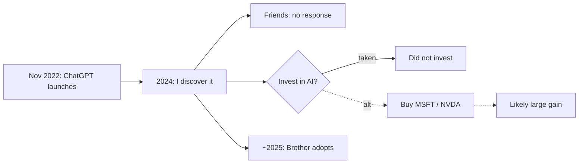

# 001 · Discovering AI (ChatGPT 3.5)

## 1. Event
- **What I noticed:** ChatGPT 3.5 could do useful knowledge work on demand.
- **Signals:** ?
- **Who I told / reaction:** Friends, no notable response. Brother adopted ~1.5 years later.

## 2. Prediction
- **Claim:** AI chat tools will go mainstream and change everyday work. *(Retroactive; not written at the time.)*
- **Timeframe:** 2-3 years
- **Confidence:** ?
- **What would prove me wrong:** Adoption stalls at hobbyists; no measurable change at work.

## 3. Options at the time
- **Possible actions:** Invest in public proxies, build AI skills, find people already in the space.
- **Taken:** Told friends; personal use (?).
- **Skipped, and why:** Investing. OpenAI was private; public proxies weren't considered. Not around investor peers.

## 4. Outcome
- **What happened:** AI went mainstream across work and markets.
- **Lag:** World Nov 2022 → me 2024 (~1-1.5 yr) → brother ~2025-26 (+1.5 yr)
- **Score:** Hit (direction)

## 5. Changes
| | Actual | Counterfactual |
|---|---|---|
| Physical | None known | None |
| Financial | No gain | AI-exposed stocks rose sharply 2024-25 (approx) |
| Time/Skills | Early familiarity (?) | Deliberate skill-building could have compounded |

## 6. Post event
- **World:** Biggest change in screen-based work (software, support, marketing, education) and in chips, cloud and data centers.
- **Local (Las Vegas):** CES made AI the headline early; hotel/casino jobs changed slowly; back-office, pricing and security adopted AI; Nevada data-center buildout is the larger effect.
- **Lessons:**
  1. Silence from friends is a signal about the audience, not the idea.
  2. If the source is private, look for the public picks-and-shovels.
  3. Write the prediction down at the time, with a confidence %.

